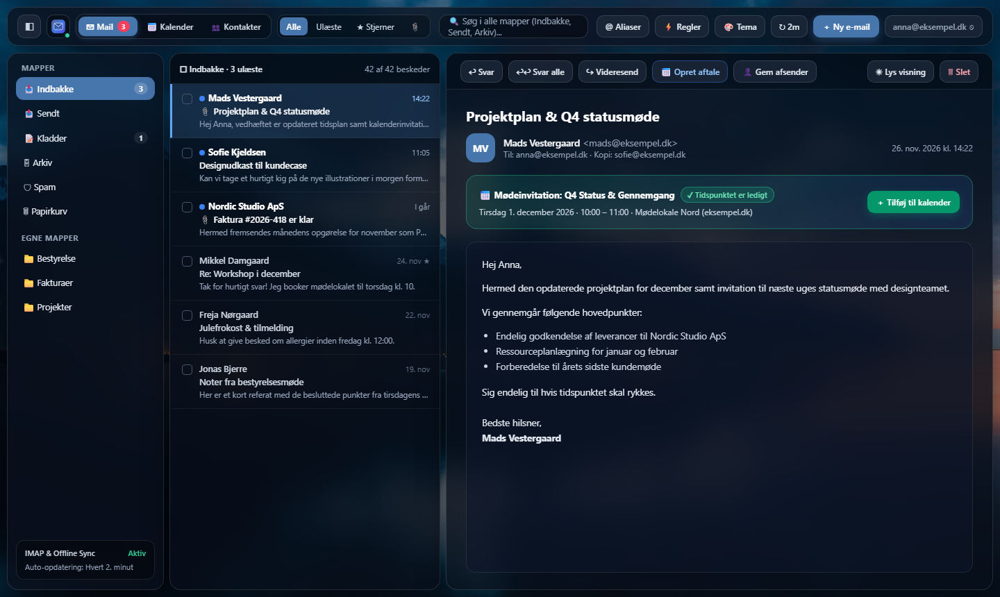
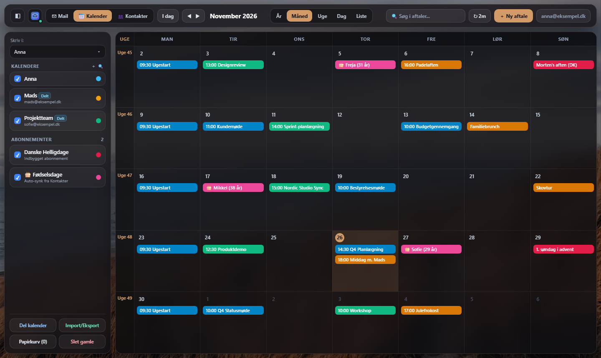
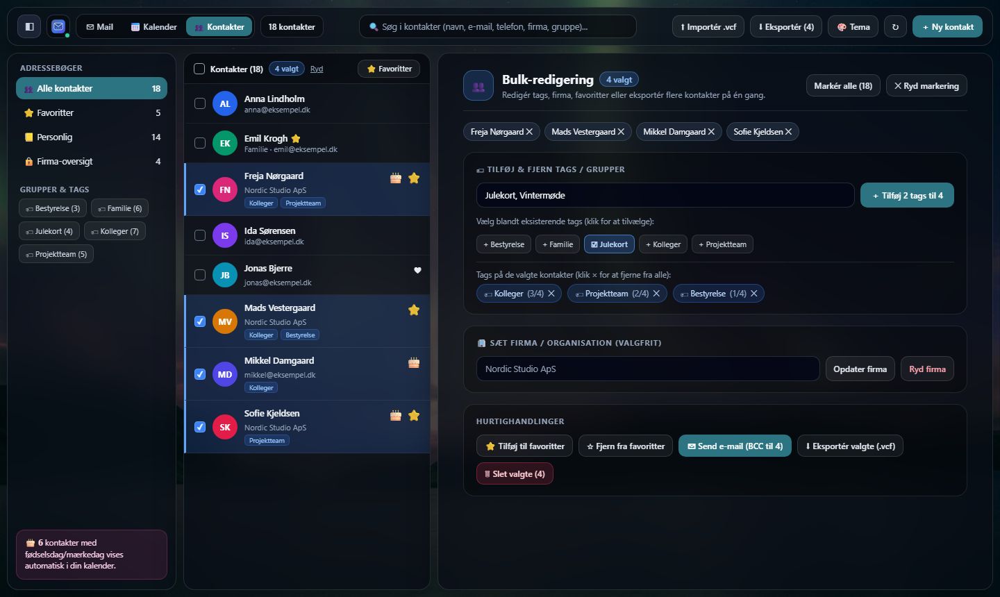
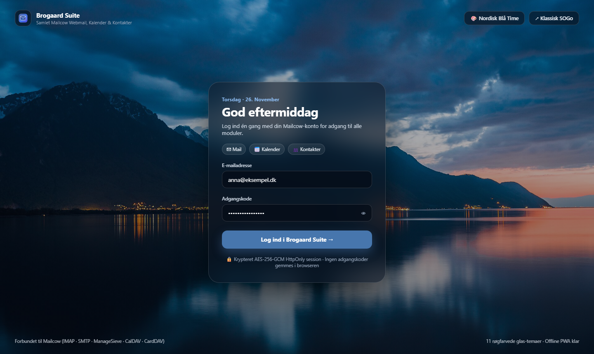

# 🧩 Brogaard Suite

**En lynhurtig, moderne og samlet Mailcow-suite med Webmail (`IMAP/SMTP/ManageSieve`), Webkalender (`CalDAV`) og Adressebog (`CardDAV`) — bygget med fælles Single Sign-On, 11 røgfarvede glas-temaer, tastaturvenlige Copy/Paste-workflows, offline PWA-understøttelse og enterprise-grade sikkerhed.**


---

## 🎯 Vision & Filosofi

**Brogaard Suite** erstatter den tunge klassiske SOGo-brugerflade ved at samle alle tre søjler fra Mailcow i én hurtig, sammenhængende og brugervenlig Vue 3 web-applikation — helt uden ekstern server-database. Alle data læses og skrives direkte mod din Mailcow-server over standardprotokollerne (`IMAP`, `SMTP`, `ManageSieve`, `CalDAV` og `CardDAV`), så mobiltelefoner, desktop-klienter og klassisk SOGo altid er i fuld synk.

---

## 📸 Skærmbilleder

> **Bemærk:** Alle skærmbilleder herunder er genereret udelukkende med fiktive demo-data (`eksempel.dk`).

### ✉️ Mail — Indbakke & 1-kliks `.ics` Konflikttjek *(Nordisk Blå Time)*


### 📅 Kalender — Månedsvisning, Delte Kalendere & Fødselsdage *(Vesterhavet i Skumring)*


### 👥 Kontakter — Flermarkering & Bulk-redigering *(Arktisk Nat)*


### 🔐 Samlet Single Sign-On Login *(Nordisk Blå Time)*


---

## ✨ Moduler & Funktioner

### ✉️ Mail (`IMAP` / `SMTP` / `ManageSieve`)
* **Fleksibelt layout & læsning:** Skift med ét klik mellem klassisk **3-kolonne** og **vandret split-visning**. Indbygget **Smart Dark-Mode** (læsbar kontrast i mørkt UI) samt hurtig **Lys visning** (hvidt papir-tema til komplekse nyhedsbreve).
* **Hurtig navigation & uendelig indlæsning:** Dato-sorteret indlæsning selv i meget store mapper (Sendt, Arkiv, Papirkurv op til 10.000 beskeder), ægte ulæst-tæller, uendelig scroll ved bunden og **`Indlæs alle`**-knap med fuld status (`X af Y beskeder`).
* **Filtre & global søgning:** Filtrér på *Alle*, *Ulæste*, *Stjerner* eller *Vedhæftninger*, og søg på tværs af alle IMAP-mapper fra toppanelet.
* **Automatiske Mailcow-aliaser & identiteter:** Henter automatisk dine send-as aliaser via SOGo DAV — og valgfri Read-Only `MAILCOW_API_KEY` for også at inkludere skjulte aliaser og domæne-aliaser.
* **ManageSieve Filterregler:** Opret, redigér og aktivér server-side e-mailregler direkte mod Dovecot port `4190`.
* **Produktivitet & oprydning:** `Ctrl+C`/`Ctrl+X`/`Ctrl+V` mellem mapper, 30 sekunders fortryd (`Ctrl+Z`), Rspamd spam/ham-træning, samt 1-kliks **`Tøm papirkurv`** / **`Tøm spam`** (via værktøjslinje og højreklik).
* **Konfigurerbar auto-synk:** Vælg automatisk opdatering hvert *1., 2. (standard), 5. eller 10. minut* eller *Kun manuelt* — inklusiv øjeblikkelig synkronisering når browservinduet kommer i fokus igen.

### 📅 Kalender (`CalDAV`)
* **5 visninger & danske ugenumre:** **År**, **Måned**, **Uge**, **Dag** og **Liste** med danske ugenumre (`Uge 1–53`) og drag-and-drop flytning/skalering af aftaler.
* **Ryddeligt sidepanel:** Diskret **`Skriv i:`**-vælger øverst til hurtigt valg af standardkalender ved nye aftaler; egne og delte kalendere samlet under **KALENDERE**; eksterne og specielle kalendere samlet under **ABONNEMENTER** nederst.
* **Direkte SOGo-kalenderdeling & offentlige links:** Del egne kalendere med andre Mailcow-brugere (**Kun læsning** eller **Læs & Skriv**), søg og abonnér på delte kollegakalendere, eller opret tidsbegrænsede offentlige Read-Only delingslinks (`?share=<token>`).
* **Tovejs farvesynk med Mailcow/SOGo:** Ændringer af kalenderfarver gemmes både i Brogaard Suite og synkroniseres direkte tilbage til Mailcow/SOGo via CalDAV `PROPPATCH`, så farverne også stemmer i SOGo og på mobilen.
* **Fødselsdage & Mærkedage (Auto-synk til Mailcow):** Kontakter med fødselsdag eller mærkedag vises nederst under **ABONNEMENTER** med alder pr. år (f.eks. `🎂 Freja (31 år)`) og kan synkroniseres tovejs ind i en dedikeret CalDAV-kalender på Mailcow, så påmindelser også virker på iOS/Android.
* **Danske Helligdage & `.ics`/`webcal://`-abonnementer:** 1-kliks indbyggede danske helligdage samt abonnement på vilkårlige `.ics` / `webcal://`-feeds.
* **Sikkerhed & oprydning:** Konfigurerbar auto-synk (`1m/2m/5m/10m/Manuel`), lokal **Papirkurv** med gendannelse, **Bulk-slet gamle aftaler**, `.ics` import/eksport, samt `Ctrl+C`/`Ctrl+X`/`Ctrl+V` og 30 sek. `Ctrl+Z` mellem dage.

### 👥 Kontakter (`CardDAV`)
* **Tovejs Mailcow CardDAV-synkronisering:** Håndterer både personlige skrivbare adressebøger og skrivebeskyttede/globale firma-adressebøger (`🔒`).
* **Detaljeret kontaktkort:** Navn, kaldenavn, stilling/firma, flere e-mails og telefonnumre, adresser med OpenStreetMap-link, hjemmeside, noter, grupper/tags, fødselsdage og mærkedage.
* **Kontaktbilleder & Favoritter:** Hurtig upload/beskæring af kontaktfotos med automatisk Gravatar-fallback samt favoritmarkering (synkroniseres på tværs af enheder selv på skrivebeskyttede adressebøger).
* **Flermarkering & Bulk-redigering:** Markér flere kontakter via afkrydsningsfelter, `Ctrl+Klik`, `Shift+Klik`, `Shift+↑/↓` eller `Ctrl+A`, og brug højre **Bulk-redigering**-panel til at:
  * **Tilføje eller fjerne tags/grupper** på op til 500 kontakter på én gang (eksekveres parallelt mod CardDAV uden duplikater).
  * **Opdatere eller rydde Firma/Organisation** samlet.
  * **Tilføje/fjerne favoritter** i én handling.
  * **Sende fælles e-mail (BCC)** til alle markerede kontakter med e-mailadresse.
  * **Eksportére (.vcf) eller slette valgte kontakter** samlet (med automatisk beskyttelse af skrivebeskyttede adressebøger).
* **vCard 3.0 Import/Eksport:** Fuld import og eksport af `.vcf`-filer inkl. hentning af eksterne profilbilleder fra f.eks. Google Kontakter-eksport.

---

## ⚡ Kryds-Integration ("Suite-Superkræfter")

Når Mail, Kalender og Kontakter bor under samme tag med ét fælles login, arbejder modulerne sømløst sammen:

1. **Én samlet Single Sign-On session:** Log ind én gang med din Mailcow e-mail og adgangskode — øjeblikkelig adgang til Mail, Kalender og Kontakter. Skift modul på 0,1 sekund via modulskifteren eller `Alt+1`, `Alt+2`, `Alt+3`. Ved log ud nulstilles adresselinjen automatisk tilbage til hovedsiden (`/`).
2. **1-Kliks `.ics` Mødeinvitation & Konflikttjek i Mail:** Når du åbner en e-mail med en kalenderinvitation (`.ics`), tjekker suiten straks alle dine aktive CalDAV-kalendere for overlap (*"✓ Tidspunktet er ledigt"* eller *"⚠️ Konflikt med ..."*) og tilføjer aftalen med ét klik.
3. **Auto-Complete på Kontakter:** Når du skriver en e-mail (`Til`, `CC`, `BCC`) eller inviterer deltagere til et kalendermøde, foreslås dine Mailcow CardDAV-kontakter automatisk mens du taster.
4. **"Gem afsender i kontakter" & "Opret aftale fra e-mail":** Tilføj nye afsendere direkte til adressebogen eller konvertér en e-mail til en kalenderaftale via værktøjslinjen eller højrekliksmenuen.
5. **Automatisk Fødselsdags- & Mærkedagskalender:** Fødselsdage og bryllups-/mærkedage fra dine kontakter vises med aktuel alder i kalenderen og kan auto-synkroniseres til Mailcow CalDAV.
6. **"Send e-mail" & "Send e-mail (BCC)" fra Kontakter:** Send direkte til én kontakt fra kontaktkortet, eller markér 20+ kontakter i bulk-visningen og åbn én ny e-mail med alle adresser samlet i `BCC`.

---

## 🎨 11 Indbyggede Røgfarvede Glas-Temaer

Temaet vælges direkte fra toppanelet og deles mellem login-skærmen og alle 3 moduler:

| Tema | Stemning / Baggrund |
| :--- | :--- |
| **Nordisk Blå Time** *(Standard)* | Fjord i blå time |
| **Vesterhavet i Skumring** | Klitter & varm horisont |
| **Nordisk Skov** | Granskov i morgentåge |
| **Arktisk Nat** | Fjeldsø & diskret nordlys |
| **80'er Neon** | Synthwave & retro-gitter |
| **3D Cyberpunk-by** | Neonlys & fremtidsby |
| **Vice City Skumring** | 3D palmer & neon-solnedgang |
| **Mørkt 3D-glas** | Abstrakt 3D-glas & lys |
| **Retro 3D-sportsvogn** | 80'er superbil i neonnat |
| **3D Rummet** | Planeter & kosmisk tåge |
| **Klassisk Mørk** | Ren mørk uden baggrundsbillede |

---

## 🔒 Sikkerhed & Hærdning (Security)

* **Fælles AES-256-GCM HttpOnly Session Cookie:** Legitimationsoplysninger gemmes aldrig i browserens `localStorage`. De krypteres med AES-256-GCM på serveren og opbevares i én sikker `HttpOnly`, `SameSite=Lax` cookie på `/api`.
* **DOMPurify HTML-Sanitering & Tracking-kontrol:** Indgående HTML-mails renses strengt mod XSS (`<script>`, `<iframe>`, `<object>`, `<form>` fjernes) før visning, og eksterne billeder kan skjules/vises med ét klik.
* **SSRF- & Origin-validering:** Mail-, CalDAV-, CardDAV- og abonnementskald valideres mod lokale loopback-, link-local- og cloud-metadata-adresser. Offentlige kalenderdelingslinks (`?share=<token>`) er låst til udelukkende at læse fra ejerens autentificerede server.
* **Rate Limiting & OWASP Headers:** Brute-force-beskyttelse på login, mail-afsendelse og offentlige delingslinks, samt streng Content Security Policy (`CSP`), `X-Frame-Options: DENY` og `Referrer-Policy: no-referrer`.
* **Hærdet Container (`USER node`):** Minimal Alpine Linux (`node:26-alpine`) med opdaterede OS-pakker, uden `npm`/`yarn`/`corepack` i runtime-imaget, afviklet under uprivilegeret bruger.

---

## ⌨️ Genvejstaster

### Globale Suite-genveje
| Handling | Genvej |
| :--- | :--- |
| **Skift til Mail / Kalender / Kontakter** | `Alt + 1` / `Alt + 2` / `Alt + 3` |
| **Luk aktiv modal / kontekstmenu / ryd markering** | `Esc` |

### Mail
| Handling | Genvej |
| :--- | :--- |
| **Skriv ny e-mail / Send e-mail (i editor)** | `Ctrl + N` / `Ctrl + Enter` |
| **Næste / Forrige e-mail (med Shift: udvid markering)** | `↓` / `↑` (`Shift + ↓/↑`) |
| **Kopiér / Klip / Indsæt i mappe** | `Ctrl + C` / `Ctrl + X` / `Ctrl + V` |
| **Markér alle / Fortryd (30 sek.)** | `Ctrl + A` / `Ctrl + Z` |
| **Flyt til papirkurv / Permanent slet** | `Delete` / `Shift + Delete` |

### Kalender
| Handling | Genvej |
| :--- | :--- |
| **Kopiér / Klip / Indsæt på valgt dag** | `Ctrl + C` / `Ctrl + X` / `Ctrl + V` |
| **Fortryd seneste handling (30 sek.)** | `Ctrl + Z` |
| **Slet valgt(e) begivenhed(er)** | `Delete` / `Backspace` |

### Kontakter
| Handling | Genvej |
| :--- | :--- |
| **Opret ny kontakt** | `Ctrl + N` |
| **Markér alle viste kontakter / Ryd markering** | `Ctrl + A` / `Esc` |
| **Næste / Forrige kontakt (med Shift: udvid markering)** | `↓` / `↑` (`Shift + ↓/↑`) |
| **Til-/fravælg enkeltkontakt eller område med musen** | `Ctrl + Klik` / `Shift + Klik` |

---

## 🐳 Kørsel i Docker (Multi-Arch: `x86_64` & `ARM64`)

Projektet bygges automatisk via GitHub Actions til både **x86 (`linux/amd64`)** og **ARM (`linux/arm64`)** og udgives på GitHub Container Registry:
**`ghcr.io/mrbridgefarm/brogaard-suite:latest`**

### Hurtig start med `compose.yaml` (og `pangolin` netværk)

```bash
# 1. Sørg for at dit "pangolin" Docker-netværk findes:
docker network inspect pangolin >/dev/null 2>&1 || docker network create pangolin

# 2. Kopiér .env.example til .env og udfyld DEFAULT_MAIL_HOST
cp .env.example .env

# 3. Hent det seneste multi-arch image og start containeren:
docker compose pull
docker compose up -d
```

I **Pangolin** kan du pege direkte på **`http://brogaard-suite:3000`**. Se også [`compose.yaml`](compose.yaml) og [`compose.example.yaml`](compose.example.yaml).

### Miljøvariabler (`.env`)

| Variabel | Standard | Beskrivelse |
| :--- | :--- | :--- |
| `PORT` | `3000` | Porten som webserveren og API-proxyen lytter på |
| `DEFAULT_MAIL_HOST` | *(tom)* | Din Mailcow-vært (f.eks. `mail.eksempel.dk`). Konfigurerer automatisk IMAP, SMTP, ManageSieve, CalDAV (`/SOGo/dav/`) og CardDAV (`/SOGo/dav/`) og skjules i login-skærmen |
| `DEFAULT_IMAP_HOST` | `DEFAULT_MAIL_HOST` | Valgfri separat IMAP-vært |
| `DEFAULT_IMAP_PORT` | `993` | Standard IMAP port (`DEFAULT_IMAP_SECURE=true` som standard) |
| `DEFAULT_SMTP_HOST` | `DEFAULT_MAIL_HOST` | Valgfri separat SMTP-vært |
| `DEFAULT_SMTP_PORT` | `465` | Standard SMTP port (`DEFAULT_SMTP_SECURE=true` som standard) |
| `DEFAULT_SIEVE_PORT` | `4190` | ManageSieve port |
| `DEFAULT_CALDAV_URL` | `https://<DEFAULT_MAIL_HOST>/SOGo/dav/` | Valgfri eksplicit CalDAV/CardDAV URL |
| `APP_MODULES` | `mail,calendar,contacts` | Styrer hvilke moduler der er aktiveret i suiten |
| `SOGO_URL` | *(tom)* | Valgfrit link til klassisk SOGo (f.eks. `https://mail.eksempel.dk/SOGo`), som giver brugere en genvej i toppanelet og på login-skærmen |
| `MAILCOW_API_KEY` | *(tom)* | Valgfri Read-Only Mailcow API-nøgle for også at hente skjulte Mailcow-aliaser og domæne-aliaser (SOGo-synlige aliaser hentes automatisk uden nøgle) |
| `MAILCOW_API_URL` | `https://<DEFAULT_MAIL_HOST>` | Valgfri eksplicit URL til Mailcow API, hvis denne adskiller sig fra DAV-værten |
| `ALLOW_INSECURE_TLS` | `false` | Sæt til `true` ved selv-signerede certifikater på lokalt LAN |
| `SESSION_SECRET` | *(auto-genereret)* | Valgfri fast krypteringsnøgle til session-cookies og delingslinks |
| `DATA_DIR` | `/app/data` | Persistent mappe til krypteringsnøgle, aliaser, abonnementer og delingslinks |

---

## 🔗 Integration med Mailcow (Frit valg mellem Brogaard Suite & SOGo)

SOGo skal **fortsat køre** på din Mailcow-server (den leverer CalDAV/CardDAV-protokollerne i baggrunden), så dine brugere bevarer fuld frihed:

1. **I Brogaard Suite (`.env`):** Sæt f.eks. `SOGO_URL=https://mail.eksempel.dk/SOGo`. Så vises et diskret **"SOGo"**-link både på loginskærmen og øverst til højre i toppanelet, hvis nogen vil skifte til klassisk SOGo.
2. **I Mailcow UI (`data/web/inc/vars.local.inc.php`):** Tilføj en genvej direkte i Mailcow's brugerpanel, så man kan vælge mellem **Brogaard Suite** og **SOGo**:

```php
<?php
$CUSTOM_APPS[] = array(
  'name' => 'Brogaard Suite',
  'link' => 'https://suite.eksempel.dk',
  'description' => 'Moderne Webmail, Kalender & Kontakter',
  'blank' => true
);
```

Genstart derefter `php-fpm-mailcow`:
```bash
docker compose restart php-fpm-mailcow
```

---

## 🛠️ Teknologisk Stack

* **Frontend:** Vue 3 (Composition API) + TypeScript + Vite 8 + Tailwind CSS + Pinia 4 + Dexie.js (IndexedDB) + VitePWA + FullCalendar (`dayGrid`, `timeGrid`, `list`, `interaction`) + specialbygget `YearView` + DOMPurify + Lucide Icons.
* **Backend:** Node.js 26 LTS + Express 5 + TypeScript + `imapflow` + `mailparser` + `nodemailer` + ManageSieve (`node:net`/`node:tls`) + `tsdav` + `ical.js` + direkte CalDAV/CardDAV XML (`PROPFIND`/`PROPPATCH`) & vCard 3.0 engine.
